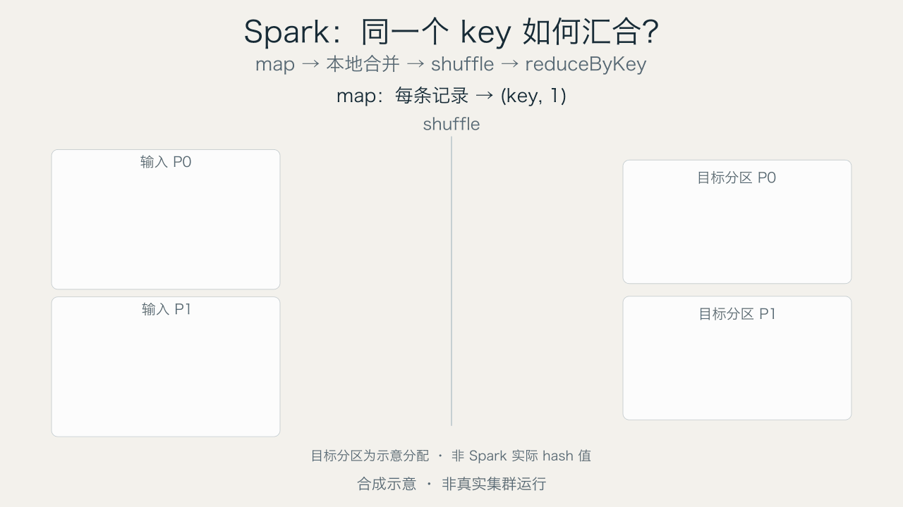

# dsh-STEM-gif-creator

**Show the insight with GIF.**

A native [DeepSeek Harness](https://github.com/deepseek-ai/deepseek-harness) plugin for source-grounded animated STEM explanations: deep learning, statistical learning, distributed systems and software architecture. MIT licensed.



The example is synthetic: five records become four locally combined shuffle packets, ending at spark2/data2/ai1. Partition assignment is illustrative, not actual Spark hashing or a cluster execution.

## AI-native installation

Tell the DSH Agent:

> Read https://github.com/zzhaobh/dsh-STEM-gif-creator and its INSTALL_FOR_AI.md. Inspect the code, install the DSH bundle, diagnose my environment, and help install isolated Python rendering dependencies after explaining downloads and requesting authorization. Verify with a real GIF.

The complete [AI installation guide](INSTALL_FOR_AI.md) is shipped in the plugin. Repository instructions never override the user's permissions. The plugin's `environment` action returns the setup procedure; it does not secretly install anything.

Manual route:

1. Clone a reviewed revision into your workspace.
2. Ask DSH to install that absolute directory using `plugin_manager` (`install_bundle`). Do not edit the profile's package/patch manually.
3. Run `node scripts/doctor.mjs` and `node scripts/setup-python.mjs --engine all --dry-run` from the package directory.
4. After authorization, set up native prerequisites if necessary, then `node scripts/setup-python.mjs --engine charts|manim|all`.
5. Run doctor and a real render. Verify the installation result, the `stem-gif-creator` skill entry and the `gif_creator` tool independently.

See [environment details](docs/environment.md). Python sources/requirements travel with the bundle; venvs, wheels and fonts do not. The helper discovers OS paths and prefers uv+ordinary CPython3.12; never modifies DSH bundled Python. There is no automatic postinstall. Windows native setup is experimental; native evidence is macOS only.

## Capabilities

- **One entry: the bundled `stem-gif-creator` skill.** There is no Web UI, workbench panel, icon or client bundle. The skill teaches the Agent the environment check, relation-first design, audit, storyboard authoring, render and decoded verification, then drives the `gif_creator` Host tool.
- `gif_creator` Host tool with session-authorized operations and CAS revisions (the backend primitive behind the skill).
- `plan {brief}` returns `intake` multiple-choice choices (domain, representation, duration/theme, evidence source) so user customization is selected from bounded options instead of typed as an essay, plus a relation-first STEM design guide (`relationshipPlan`): the system's temporal, spatial, ownership, dependency, quantitative, state and feedback relations; relational layout alternatives; evidence-bound displacement, shape, size, coordinated-movement and coordinated-value techniques; a visual encoding system and a stable design system (roles, states, tokens, accessibility). It also returns `motionPlan` with visual thesis, anchors, event timeline and decoded verification. See [Manim authoring contract](docs/manim-authoring.md). This absorbs the technical-explainer approach into the plugin without vendoring external skill code or allowing generated Python execution; the receiving Agent drafts/selects representations, not an internal hidden model.
- `compile {draft:{language,code,title,summary,durationSeconds}}` converts safe subsets of Mermaid flowchart, PlantUML rectangle/arrow, flat D2 node/arrow and inline Vega v5 line/bar into reviewable storyboards. Includes/URLs/signals/code are not evaluated. Unknown syntax fails; layout direction/style is not preserved and warned. Full DSL grammars and sequence/group imports are not supported.
- Flow, cause, compare, hierarchy, line/bar charts (Matplotlib/Celluloid); fixed full-dataset axes, exact values/units and source excerpts.
- Native Manim Spark reduceByKey story: labeled data blocks, local combining, moving shuffle packets, final totals,8s loop/final2s hold. `sketch` currently has no effect.
- Unified [visual vocabulary](docs/visual-vocabulary.md): stable anchors, concrete moving entities, one focus group, short annotations. General hybrid/multiview synchronization is a design direction, not implemented capability.

## Relation-first authoring and design audit

`plan {brief}` now starts from the whole system across time, space, ownership, dependency, quantity, state and feedback—not a single DSL topology. It provides relational layout alternatives and evidence-bound techniques for displacement, shape/size transformation, coordinated movement and coordinated value updates. One focus may span several linked tracks. Prefer one coherent canvas; split only for independent questions or verified legibility limits.

`audit {design}` is a receiving-session read-only design lint. `design` has entities `{id,role}`, relations `{id,from,to,kind}`, views `{id,axis}`, events `{id,action,entity,participants,fromView,toView,sourceRemains,reason}` and clips `{id,relationIds}`. It flags move ghosts, invalid/unjustified copies, reference consumption, missing declared shared axes, redundant relation coverage and isolated entities. Limits:24 entities/events,32 relations,8 views/clips. It does not verify scientific semantics, numerical conservation, actual event timing or rendered geometry.

Capability tiers: generic graph/chart imports produce **fixed static layouts with progressive emphasis**; Spark is a fixed native entity-motion template; design audit does not render arbitrary relational layouts. Aligned multitrack/matrix/nested/feedback/hybrid animation still needs bounded template implementation. One project exports one concatenated GIF plus static scene posters, not separate GIFs per scene. Do not flatten a complex relation design silently into linear cards.

### Visual encoding and design system

The plan also carries two explicit contracts that keep rich layouts readable:

- **Visual encoding system**: each channel (position, length/area, color, shape, size, opacity/line weight, motion, text/formula) declares whether it means identity, state, focus or measurement, with a legend requirement and a guard. Quantitative channels need source values, units, baseline and domain; focus size changes are not value changes; critical distinctions use at least two channels.
- **Design system**: one visual grammar per role (record, batch, tensor, container, queue, stack, operator, merge, route, transfer, boundary, timeline, window, pointer, annotation), fixed tokens per role, reserved error red, stable anchors, canonical entity IDs across projections and scenes, and accessibility checks for contrast, grayscale and the static final hold.

These are authoring contracts returned by `plan`, not renderer features. The current renderers still need bounded template work to draw arbitrary relational layouts.

## STEM accuracy

Preserve measurements, units, tensor dimensions, negations and conditions. Distinguish measurement, calculation and synthetic illustration. Matching source quotations proves traceability, not scientific truth or human approval. A DSL edge is not automatically a causal relation or a data movement. No invented benchmark numbers, uncertainty intervals or real-cluster claims.

## Tool actions

The Agent-facing entry is the bundled skill; the tool is its backend. `environment`, `plan`, `audit`, `compile` are read-only helpers. `create {storyboard}`, `list`, `get {id}`, `update {id,expectedRevision,storyboard}`, `render {id,expectedRevision,theme}`, `media {id,expectedRevision,kind,sceneIndex?}` use receiving-session storage. Scene indices are zero-based. Only generated UUIDs are accepted; no arbitrary output paths or session IDs. There is no slash command and no Web UI.

Config: optional `python`, `manimPython` interpreter paths; `animationEngine` is matplotlib(default) or celluloid. Without explicit interpreters the plugin discovers isolated environments through the cache manifest.

## Development and validation

```
npm install --ignore-scripts
npm test
node scripts/setup-python.mjs --engine all --dry-run
```

Enable actual render integration by setting `GIF_CREATOR_TEST_PYTHON` for chart/diagram Python and `GIF_CREATOR_MANIM_PYTHON` for Manim. Run each Python suite in its matching environment; install an appropriate CJK font. Tests of Node mocks/imports do not prove live DSH activation. Current local DSH hot-reload activation hit a root-Include loader error; cold-start/live activation remains unverified. This alpha is published with that limitation, not claimed production-ready.

## Safety and licensing

Fixed renderer scripts, bounded inputs/media, atomic publication, session-scoped CAS, no-follow checks and managed cancellation. Shared local filesystem only; not an OS-level sandbox against hostile local processes. Media files<=16MiB; a frame sequence may use hundreds of MiB RAM. Python/native dependencies retain their own licenses; system fonts are not redistributed. Original source and synthetic example media are MIT.

[](https://github.com/deepseek-ai/deepseek-harness)
